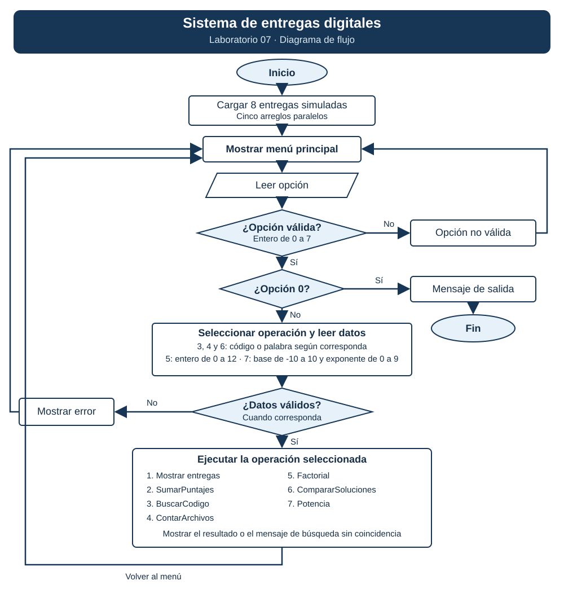

# Laboratorio 07 — Recursividad

Sistema de análisis de entregas digitales para un curso universitario.

**Autor:** Mauricio Arias Villanueva  
**Curso:** Fundamentos de Programación  
**Universidad:** Universidad Privada del Norte (UPN)  
**Lenguaje:** C# · .NET 10

## Estado

Código implementado. Se documentaron 15 pruebas manuales realizadas en Visual Studio Code el 25/11/2026, con resultados acordes al código. Los casos sin evidencia de ejecución se mantienen como verificaciones adicionales.

## Funcionalidades

| Opción | Operación |
|---|---|
| 1 | Mostrar las ocho entregas simuladas con código, archivo, intentos, puntaje y observaciones. |
| 2 | Sumar los puntajes mediante recursividad. |
| 3 | Buscar un código mediante recursividad y mostrar la entrega encontrada. |
| 4 | Contar los archivos cuyo nombre contiene una palabra clave. |
| 5 | Calcular un factorial recursivo. |
| 6 | Comparar suma, búsqueda y conteo en sus versiones recursiva e iterativa. |
| 7 | Calcular una potencia recursiva. |
| 0 | Salir. |

La búsqueda y el conteo no distinguen mayúsculas de minúsculas. El conteo suma un archivo por coincidencia, aunque la palabra aparezca varias veces en su nombre.

## Estructura

| Archivo | Responsabilidad |
|---|---|
| `Program.cs` | Menú, datos simulados, validaciones y métodos recursivos e iterativos. |
| `Laboratorio07.csproj` | Configuración del proyecto de consola en .NET 10. |
| `.gitignore` | Exclusión de `bin/`, `obj/` y `.vs/`. |
| `README.md` | Descripción, ejecución y resultados de las pruebas manuales. |

Los cinco arreglos son paralelos: una misma posición representa una entrega completa. Tienen ocho elementos cada uno y los códigos son únicos.

## Descargar y ejecutar

Requisito: SDK de .NET 10. Visual Studio Code es el editor recomendado.

```bash
git clone https://github.com/MauricioAriasVillanueva/LABORATORIO-07.git
cd LABORATORIO-07
dotnet run --project Laboratorio07.csproj
```

Si ya tienes una copia del repositorio y no hay cambios locales pendientes:

```bash
git pull --ff-only origin main
dotnet run --project Laboratorio07.csproj
```

Para compilar sin ejecutar:

```bash
dotnet build Laboratorio07.csproj
```

Estos comandos permiten reproducir las pruebas en un equipo con el SDK de .NET 10.

## Diagrama de flujo



El menú se repite después de cada operación o entrada inválida; la opción 0 finaliza el programa.

## Organización del código

- `MostrarMenu()` presenta las opciones; `Main()` controla el ciclo y las llamadas.
- `MostrarEntregas()` recorre los datos con un `for`; `MostrarEntrega()` muestra un registro.
- Los métodos `Consultar...` reciben y validan las entradas antes de llamar a los cálculos.
- `CompararSoluciones()` calcula las tres operaciones con las mismas entradas y muestra ambos resultados.
- Los métodos de cálculo reciben los arreglos como parámetros y devuelven resultados con `return`.

## Funciones recursivas

| Función | Caso base | Avance | Resultado |
|---|---|---|---|
| `SumarPuntajes` | Índice mayor o igual a la longitud: 0. | Índice + 1. | Puntaje actual más la suma restante. |
| `BuscarCodigo` | Fin del arreglo: -1; coincidencia: índice actual. | Índice + 1. | Primer índice encontrado o -1. |
| `ContarArchivos` | Fin del arreglo: 0. | Índice + 1. | Coincidencia actual más el conteo restante. |
| `Factorial` | Número igual a 0: 1. | Número - 1. | Número multiplicado por el factorial anterior. |
| `Potencia` | Exponente igual a 0: 1. | Exponente - 1. | Base multiplicada por la potencia anterior. |

Los recorridos comienzan en el índice 0. El caso base se comprueba antes de acceder al arreglo, por lo que los métodos de suma, búsqueda y conteo admiten arreglos vacíos.

## Validaciones y límites

- El menú acepta enteros de 0 a 7. Una entrada vacía, texto u opción fuera de rango muestra un mensaje.
- El código y la palabra clave no pueden quedar vacíos después de quitar espacios de los extremos.
- Factorial: enteros de 0 a 12. Se limita para mantener el resultado dentro del tipo `int`.
- Potencia: base entera entre -10 y 10 y exponente entero entre 0 y 9. Estos límites controlan el resultado y la profundidad de las llamadas.
- Para este ejercicio, toda potencia con exponente 0 devuelve 1, incluido `0^0`.
- Una entrada inválida vuelve al menú; no inicia el cálculo.
- Si se cierra la entrada estándar, el menú finaliza.

Los métodos recursivos de factorial y potencia suponen que sus argumentos ya fueron validados por los métodos de consulta. No deben llamarse directamente con argumentos fuera de sus contratos.

## Recursividad e iteración

| Operación | Versión recursiva | Versión iterativa |
|---|---|---|
| Sumatoria | `SumarPuntajes` | `SumarPuntajesIterativo` |
| Búsqueda | `BuscarCodigo` | `BuscarCodigoIterativo` |
| Conteo | `ContarArchivos` | `ContarArchivosIterativo` |

Ambas estrategias recorren hasta n elementos. La recursividad permite expresar el caso base y el avance de forma directa, pero puede mantener hasta n + 1 llamadas activas en estos recorridos. Los bucles usan memoria auxiliar constante y son preferibles para colecciones grandes.

Riesgos que deben revisarse al modificar el código: omitir el caso base, no avanzar hacia él, acceder al arreglo antes de comprobar su límite y permitir demasiadas llamadas. Los datos actuales son ocho entregas fijas; no se aceptan colecciones grandes desde el menú.

## Pruebas manuales realizadas

Resultados registrados en las capturas de ejecución del 25/11/2026. Se comparó cada salida con el resultado esperado según los datos y las reglas del programa.

| N.º | Caso | Entrada | Resultado esperado | Resultado obtenido |
|---|---|---|---|---|
| 1 | Sumatoria | Opción 2 | 122 | 122 |
| 2 | Código existente | Opción 3: N00003 | ejercicio_01.cs; 12 puntos | ejercicio_01.cs; 12 puntos |
| 3 | Búsqueda vacía | Opción 3: vacío | Rechazar código vacío | El codigo no puede estar vacio. |
| 4 | Conteo | Opción 4: final | 3 archivos | 3 |
| 5 | Conteo | Opción 4: v2 | 2 archivos | 2 |
| 6 | Palabra sin coincidencias | Opción 4: foto | 0 archivos | 0 |
| 7 | Caso base factorial | Opción 5: 0 | 1 | 1 |
| 8 | Caso recursivo factorial | Opción 5: 4 | 24 | 24 |
| 9 | Factorial negativo | Opción 5: -1 | Rechazar entrada | Dato invalido. |
| 10 | Factorial fuera del límite | Opción 5: 13 | Rechazar entrada | Dato invalido. |
| 11 | Comparación | Opción 6: N00003 y final | Suma 122, índice 2, conteo 3 en ambas versiones | 122 / 2 / 3 en ambas versiones |
| 12 | Potencia recursiva | Opción 7: base 2, exponente 5 | 32 | 32 |
| 13 | Caso base potencia | Opción 7: base 3, exponente 0 | 1 | 1 |
| 14 | Menú inválido | hola | Rechazar opción | Opcion no valida. |
| 15 | Salida | Opción 0 | Finalizar programa | Saliendo del sistema; retorno a la terminal |

### Comparación de resultados

| Operación | Recursiva | Iterativa |
|---|---:|---:|
| Sumatoria | 122 | 122 |
| Búsqueda de N00003 (índice) | 2 | 2 |
| Conteo de final | 3 | 3 |

Las tres operaciones coincidieron para las entradas probadas.

### Verificaciones adicionales

La revisión de los casos base permite deducir que un arreglo vacío devuelve 0 en suma y conteo y -1 en búsqueda. Estos resultados, así como la búsqueda de un código inexistente desde la opción 3, no se registran como pruebas ejecutadas porque no se dispone de capturas que los acrediten. Para probar un arreglo vacío se puede utilizar una copia local temporal, sin modificar los ocho registros del proyecto entregado.

## Alcance

Los datos son simulados y se mantienen en memoria. No se incluye registro interactivo, persistencia, interfaz gráfica ni bibliotecas externas. El informe académico y las capturas originales se conservan por separado; este README resume los resultados de las pruebas documentadas.
